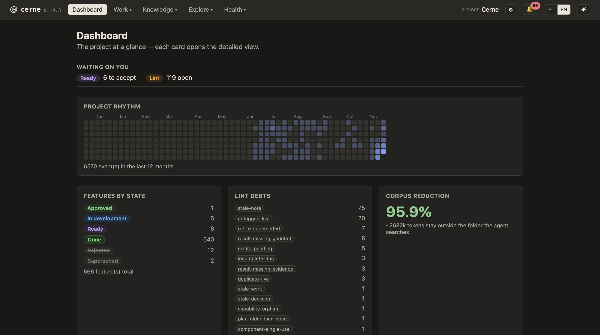
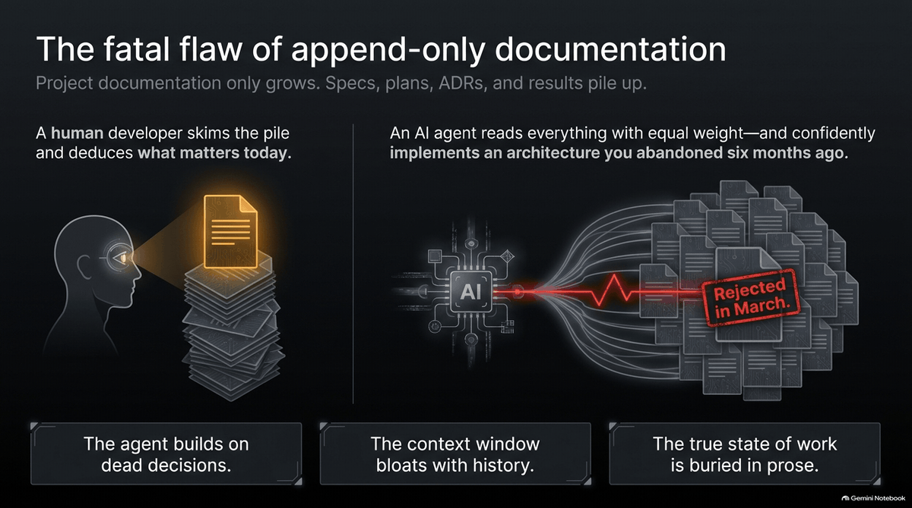
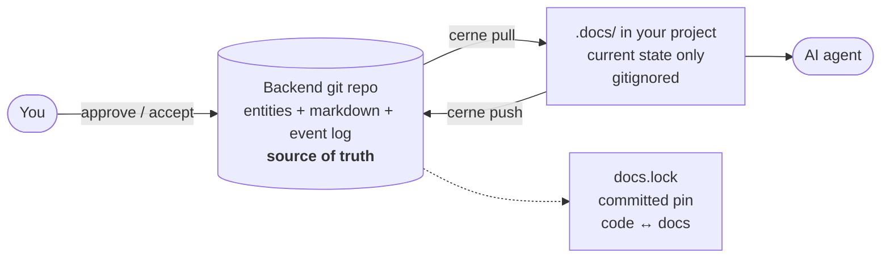
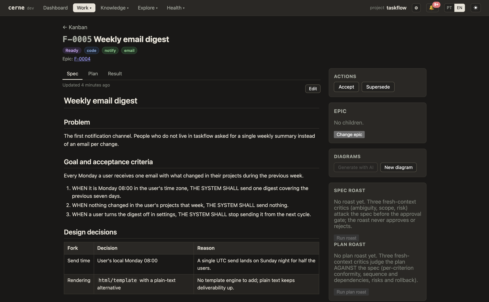
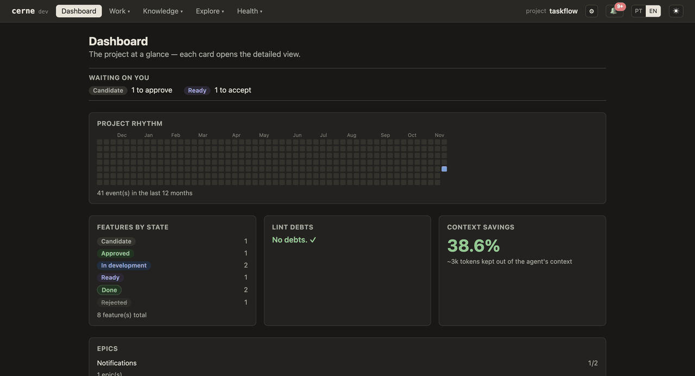
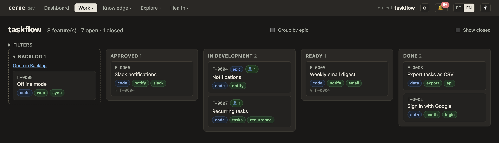
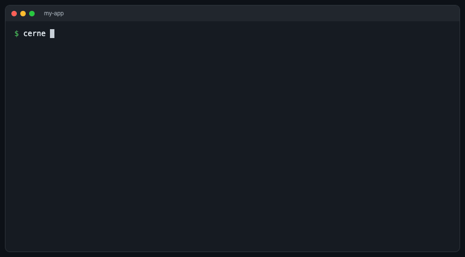

<p align="center">
  <picture>
    <source media="(prefers-color-scheme: dark)" srcset="docs/assets/logo/cerne-mark-dark.svg">
    
  </picture>
</p>

<h1 align="center">cerne</h1>

<p align="center">
  <strong>An engineering workflow for software built with AI agents.</strong><br>
  Features, decisions and project knowledge live as versioned, structured data in a git repository you choose.<br>
  Agents read only what is current, the full history stays searchable, and approvals stay with a human.
</p>

<p align="center">
  Single Go binary · runs locally · no account, no SaaS, no telemetry · Apache 2.0
</p>

<p align="center">
  <a href="https://github.com/henriquesakata/cerne/releases/latest"></a>
  <a href="https://github.com/henriquesakata/cerne/actions/workflows/ci.yml"></a>
  <a href="LICENSE"></a>
  
</p>

<p align="center">
  <a href="#the-problem">Problem</a> ·
  <a href="#how-it-works">How it works</a> ·
  <a href="#quickstart">Quickstart</a> ·
  <a href="#capabilities">Capabilities</a> ·
  <a href="#agent-integrations">Agents</a> ·
  <a href="#where-your-data-goes">Your data</a> ·
  <a href="#what-cerne-does-not-do">What it does not do</a> ·
  <a href="#status-and-limitations">Status</a> ·
  <a href="INSTALL.md">Install guide</a>
</p>



*cerne's own dashboard, captured in November 2026 when the project had 403 features. cerne is developed with cerne, and the open lint debts on screen are real. The figures elsewhere in this README were measured later, on 2026-11-16.*

cerne is not a wiki, an agent memory or a documentation generator. It gives the work itself a lifecycle: a feature moves from `candidate` to `done` only through gated commands, a decision is superseded instead of rewritten, and every transition is an event in git. Because state is data rather than prose, cerne can hand the agent a projection of what is true today, check the documentation for staleness without an LLM, and refuse an agent session that tries to approve its own spec.

## The problem

When agents work on the same codebase for months, often several at once, the same failures come back:

- **Documentation only grows.** Specs, plans, ADRs and results pile up, and nothing mechanical separates the document that holds today from one rejected or superseded months ago.
- **Agents build on dead decisions.** An agent gives every document it finds the same weight, and confidently follows a design that was replaced.
- **Feature state lives in prose.** A "Status: WIP" line in a markdown file goes stale, and there is no reliable answer to "what is in progress, and who is on it?"
- **Context is too big, or missing.** Loading everything costs tokens and buries what matters; loading nothing means explaining the project again in every session.
- **Agents drift apart.** Without a reviewed spec and shared conventions, two agents solve the same concern in two different ways.
- **Knowledge stays in one session.** What an agent learned lives in its transcript, on one machine, inside one tool, and the next session repeats the mistake.

cerne treats project knowledge as data with a lifecycle, so each of these has a mechanical answer instead of a habit to remember.



## How it works

### History, state and context are kept apart



- **History: the backend.** A plain git repository you own, separate from your code's: a folder on your machine, a git server you run, or a private repository on GitHub or GitLab. Entities are JSON, document content is markdown, and every state transition is an event in an NDJSON log. Nothing is deleted: rejected features and superseded decisions stay, with the reason they left.
- **State: lifecycle data.** Every feature, decision, note, runbook and reference has a state that only a gated command can change (`cerne feature approve`, `cerne decision supersede`…). A document never declares its own status.
- **Context: the `.docs/` projection.** `cerne pull` writes a gitignored `.docs/` folder with a generated `CONTEXT.md` (the roster of features and their states, the work in progress, the active decisions, notes, runbooks and references) and the documents of live entities only: features still in candidate, approved or in development, active decisions, runbooks and notes, current references. Implemented and done features keep one line in the roster; their documents stay in the backend. Rejected and superseded work does not appear at all.

Keeping history does not mean the agent reads it. This is what reaches an agent, and how:

| Layer | What it holds | How the agent gets it |
|---|---|---|
| Backend | Everything ever written, in every state | Never automatically. On demand, through `cerne search`, `cerne ask` and `cerne show <id>` |
| `.docs/` | The current state only | Files on disk. The installed skill tells the agent to start at `CONTEXT.md` and open what its task needs |
| Session start (hooks) | A short block of workflow rules and the board of work in progress | Injected automatically by the hooks `cerne init` installs |

Measured with `cerne savings` on this repository on 2026-11-16, when its backend held 459 features (439 of them done):

| | Entities | ~Tokens |
|---|---:|---:|
| Everything in the backend, all states | 663 | 2,193,000 |
| Projected into `.docs/` | 206 | 79,000 |

96.4% of the stored documentation stays out of the projection, and none of it is lost. Two caveats. Token figures are a bytes/4 estimate, not a tokenizer count. And the projected figure counts entity documents only, not the generated `CONTEXT.md`, which was about 100 KB here on the same day, mostly one roster line per feature. It is what the projection makes available, not what a session loads. Run `cerne savings` on your own project to get your numbers.

### The lifecycle, and where the human decides

A feature moves `candidate → approved → in_development → implemented → done`, or leaves as `rejected` or `superseded`. Each step has a gate: `approve` needs a real spec, `start` a real plan, `complete` a real result. Epics, tasks and bug reports share the same lifecycle.

Two steps are human acts by default: **approving** the spec, before any code is written, and **accepting** the result, after it is built. The hooks mark agent sessions with `CERNE_ACTOR=agent`, and cerne refuses those two transitions from such a session unless the project's `.cernerc` sets them to `auto`. In the dashboard, each is one click.

The agent does the volume: the spec, the plan, the code, the evidence. You keep the two decisions that matter, what gets built and whether it is good enough, at the points where your judgment is cheapest and counts most: a page to approve before the build, and evidence to read after it.

| | You, in the browser (`cerne ui`) | Your agent, in the terminal |
|---|---|---|
| **Starting work** | Describe a feature, or read the spec the agent drafted | Registers the feature and writes its spec |
| **The gate in** | **Approve** the spec. The agent cannot | Waits for your approval, then plans and builds |
| **While it runs** | Watch the board move; see what each agent is on | Moves the feature through the lifecycle as it works |
| **The gate out** | Read the result and its evidence, then **Accept** | Writes the result, with evidence for each acceptance criterion |
| **Later** | Search why something was decided or rejected | Reads only what is current, and searches history when it needs the why |

An optional quality loop, the **Gauntlet**, goes further: the spec must carry a literal bar line (`Bar:`) that the delivery is measured against, and the result must quote a judge's verdict against that bar. New projects start with it off; turn it on in the dashboard settings or with `cerne settings set gates.gauntlet on --scope project`.



### Decisions, conventions and project knowledge

Features are one kind of entity. The others carry what a project knows, each with its own lifecycle:

- **Decisions (ADRs).** Active until superseded by another decision (`cerne decision supersede --by D-…`) or retired with a reason. Only active decisions are projected. `cerne lint` flags documents that still point at a superseded decision, and decisions nobody has reviewed for a while (`cerne decision keep` records that one still holds).
- **Notes.** Durable facts and gotchas an agent or a person learned. A note tagged with the reserved `convention` component is prescriptive ("how we build forms here") and has its own view in the dashboard: this is where shared conventions live, so every agent reads the same ones.
- **Runbooks.** Operational procedures: deploys, migrations, environment access.
- **References.** External articles, docs or specs registered as provenance (`cerne reference new "<title>" --url <url> --informs F-…,D-…`). Their content is indexed, so `cerne ask` can cite them, and `cerne lint` flags a feature or decision that cites an external URL with no reference behind it.
- **Errata.** A correction appended to a concluded feature or decision, without rewriting its history.

The `cerne-self-learning` skill tells the agent to file a lesson the project should keep (a hard-won fix, a multi-step procedure) as a note or runbook in the backend rather than in its local memory, so the next session (another agent, another machine, another tool) starts with it.

### How agents plug in

The agent works through the CLI; its read commands take `--json`. `cerne init` installs what teaches it the workflow:

- **Skills.** `cerne-authoring` covers the lifecycle mechanics: which command to run, which gate comes next, what never to do (approve its own spec, hand-edit `CONTEXT.md`). `cerne-self-learning` covers the knowledge capture above.
- **Hooks.** At session start, the workflow rules and the work in progress. After a command runs, a reminder to register an external source. At the end of a turn, a closeout check. Before context compaction, a handoff code so the next session can resume. Plus an optional gate that denies file edits until the session has registered what it is working on.
- **Coordination.** Work entries (`W-`) show who is on what; handoffs (`HO-`) pass a task between sessions with one code; `feature new` and `work start` refuse a title close to one already in flight.

Agents without a shell can use the read-only [MCP server](#agents-without-a-shell-mcp).

### Compared with other approaches

| | Knows the state of work | Versioned with the code | Agent reads only what is current |
|---|:---:|:---:|:---:|
| Issue tracker (Jira, Linear) | yes | no | no |
| Docs-as-code (markdown, ADR folders) | no | yes | no |
| RAG over your docs | no | no | no: retrieval ranks by similarity, not by whether a text still holds |
| **cerne** | **yes** | **yes** (`docs.lock` pins a snapshot per commit) | **yes** |

The idea is close to Karpathy's [LLM Wiki](https://gist.github.com/karpathy/442a6bf555914893e9891c11519de94f), with one difference: the lifecycle is data, so staleness is checked by a deterministic lint instead of a model's judgment.

### Why a separate repository

Documentation does not always belong to one version of the code, and it does not have to follow the code's lifecycle. A product with several branches in production shares the same decisions, conventions and most of its features; copying them into each branch is how documents start to contradict each other. With one documentation repository, every branch shares the same base, the `docs.lock` in each branch records which snapshot that code goes with (so a checkout from last year reads last year's docs), and a document that applies to only one version can carry a tag or a module.

## See it running





Apart from the dashboard at the top of this page, the screenshots are from the [demo project](examples/demo/README.md). An empty project does not show what cerne is for, so `cerne demo` builds a fictional one with a realistic history (features in every state, a rejected proposal, a superseded decision, an epic) from documents embedded in the binary: no clone, no network, a few seconds, on macOS, Linux and Windows.

```bash
cerne demo
cd cerne-demo/taskflow && cerne ui
```

What is in it and what to try: [examples/demo](examples/demo/README.md). On a cerne older than v0.13.0, which added `cerne demo`, the clone still works: `git clone https://github.com/henriquesakata/cerne && sh cerne/examples/demo/seed.sh`.

## Quickstart

Install with Homebrew (macOS or Linux):

```bash
brew install henriquesakata/tap/cerne
```

Or with the install script, on macOS or Linux:

```bash
curl -fsSL https://raw.githubusercontent.com/henriquesakata/cerne/main/install.sh | sh
```

On Windows, in PowerShell:

```powershell
irm https://raw.githubusercontent.com/henriquesakata/cerne/main/install.ps1 | iex
```

The scripts download the latest release for your machine, verify its SHA-256 and install it without admin rights. To install by hand or with Go, or to verify a release's provenance, see [INSTALL.md](INSTALL.md).

Then, inside your project's git repository (with no `--backend`, `init` creates a local backend for you):

<!-- quickstart -->
```bash
cerne init --name my-project
cerne ui        # your dashboard, at http://localhost:7717
```

Commit the files `init` wrote at the root (`.cernerc`, `docs.lock`, `.gitattributes`, `.gitignore`). For a team, pass `--backend` an empty private repository on GitHub or GitLab instead; `init` prints how to move a local backend to a remote later. Documents are scaffolded in English; add `--docs-language pt-BR` for Portuguese.

Now open your agent in the project and ask for something: *"add sign in with Google"*. It registers the feature and drafts the spec, and the card shows up on your board, waiting for your approval. Claude Code picks up everything `init` installed; for the other agents, see [Agent integrations](#agent-integrations).

You do not type the commands below. This is your agent's shell: what it runs when you ask for a feature, and what it reads after you reject one. The rejected feature leaves its context and stays one search away.



<details>
<summary>Prefer the terminal, or working without an agent? The same flow by hand.</summary>

```bash
cerne feature new "Sign in with Google" --context "Users asked for social login."
cerne pull      # materializes the current state into .docs/
# edit .docs/current/features/F-0001-…/spec.md, then:
cerne push      # sends your edits back to the backend
cerne status    # features grouped by state
cerne search google   # history stays searchable
```

Every command is there for you too: nothing the agent does is hidden or out of reach. All commands: `cerne --help`.

</details>

### Already have a project?

If it already has documentation (specs, ADRs, RFCs, plans, in any layout), bring it in. cerne maps the tree with your AI and shows the plan before writing anything:

```bash
cerne import --agent                  # map the docs; the plan lands in .docs/import/
cerne import --agent --ingest         # validate the plan and show what it would create
cerne import --agent --ingest --yes   # apply it
```

`--root <dir>` points it at a docs folder other than the project root. With a subscription CLI or an API key set, cerne drafts the plan itself; in delegation mode it hands the mapping prompt to the agent you already run.

A project with only code needs no import: run `cerne init`, then ask your agent to register the features in progress and the decisions in force (`cerne feature new`, `cerne decision new`). From there, new work follows the normal flow.

### Agents without a shell: MCP

`cerne mcp` serves the project to any MCP client over stdio, with seven read-only tools: `status`, `brief`, `next`, `search`, `show` and `ask` return exactly what the command of the same name prints with `--json`, and `guide` answers how to use cerne itself from its skill, help and FAQ. None writes anything, and `ask` returns the ranked sources without calling a model.

In a project-scoped config (for example a `.mcp.json` at the project root, which the client starts from there):

```json
{
  "mcpServers": {
    "cerne": { "command": "cerne", "args": ["mcp"] }
  }
}
```

In a global client config, name the project with `--dir`:

```json
{
  "mcpServers": {
    "cerne": { "command": "cerne", "args": ["mcp", "--dir", "/path/to/your/project"] }
  }
}
```

Outside a cerne project the server still starts, with only the `guide` tool, and tells the agent that `cerne init` starts a project.

Clients that install MCP Bundles (MCPB) can take the server straight from a release: every release after 0.14.3 ships `cerne_<tag>.mcpb`, with the binaries for every platform. The client asks for the project folder and starts `cerne mcp --dir` on it; the folder must already be a cerne project. The bundle is also what the [official MCP Registry](https://registry.modelcontextprotocol.io) entry `io.github.henriquesakata/cerne` points to.

## Capabilities

| Area | What cerne does |
|---|---|
| **Lifecycle and governance** | Gated feature lifecycle with human approve and accept; epics, tasks and bug reports on the same lifecycle; ideas (`I-`) triaged before they become demand; pendings (`P-`) for known delivery debts; a capability taxonomy (`C-`) of what the product does; the optional Gauntlet. |
| **Decisions and knowledge** | ADRs with supersession and periodic review, notes and conventions, runbooks, references as provenance, errata on concluded work. |
| **Context for agents** | The `.docs/` projection and `CONTEXT.md`; cheap views for priming (`cerne brief`, `cerne status --active`, `cerne next`); `cerne show <id>` for any entity, projected or not. |
| **Search and Q&A over history** | Full-text search (SQLite FTS5) over everything, rejected and superseded included. `cerne ask` answers with citations, or returns only the sources. `cerne graph` exports the relationships between entities. |
| **Deterministic lint** | Rules over state, not prose: references to superseded decisions, broken links, orphans, missing gate documents, results without evidence, unregistered sources, stale decisions and notes, duplicate live features, epics out of step with their children. `cerne drift` flags implemented features whose code changed since. |
| **Parallel agents** | Per-document 3-way merge on `pull`, auto-rebase on `push`, `cerne sync` as one forward path, a conflict-free `docs.lock` across branches and worktrees, work entries and handoffs, commit-message checks through git hooks. |
| **Dashboard** | `cerne ui`: what waits on you, the kanban board, epics, decisions, conventions, agent activity, flow metrics, token costs, lint debts, context savings, settings. English and Portuguese. |
| **Measurement** | `cerne savings` (what the projection keeps out), `cerne stats` (lead time, cycle time, throughput from the event log), `cerne cost` (tokens a feature consumed, read from Claude Code transcripts). |
| **Adoption** | `cerne init`, `cerne import --agent`, `cerne demo`, documents in English or Portuguese, an optional Open Knowledge Format–compatible projection (`cerne pull --okf`). |

## Agent integrations

cerne is built for Claude Code, Cursor, Codex CLI, Gemini CLI and GitHub Copilot, and has been used extensively only with Claude Code. Support for Cursor, Codex CLI and GitHub Copilot grew in November 2026 and passed each delivery's tests, but has seen little real use yet. "Supported" below means cerne installs the files; it does not mean the integration has been validated in daily use.

| Agent | What `init` / `cerne hook install` delivers | How it has been tested |
|---|---|---|
| **Claude Code** | Both skills in `.claude/skills/`, seven hooks and `CERNE_ACTOR=agent` in `.claude/settings.json` | **Extensively.** cerne is developed with it every day |
| **Cursor** | A rule in `.cursor/rules/cerne.mdc`, hooks, the authoring guide in `.cursor/skills/` | **Partially.** Light use; some hooks are degraded or not wired yet |
| **Codex CLI** | Hooks and `.codex/config.toml`, the guide in `.agents/skills/` plus a pointer in `AGENTS.md` | **Early testing.** Built from Codex's documentation; hands-on testing has only just started |
| **Gemini CLI** | `.gemini/settings.json` and `.gemini/.env`, the guide in `.gemini/skills/` plus a pointer in `GEMINI.md` | **Not tested.** Built from Gemini's documentation |
| **GitHub Copilot** | An instructions file in `.github/instructions/cerne.instructions.md`, hooks in `.github/hooks/cerne.json`, the guide in `.github/skills/` | **Early testing.** Hooks probed on Copilot CLI; VS Code agent mode and the cloud agent are not verified |
| **Any MCP client** | `cerne mcp`, read-only, over stdio | Covered by automated tests through the MCP Go SDK client; not validated against specific clients |

`init` delivers the guide to Claude Code always, and to the other agents only when their config folder (`.cursor/`, `.codex/`, `.gemini/`) exists in the project; it prints one line per agent, including the ones not detected. To add one whose folder is missing:

```bash
cerne hook install --provider cursor,codex,gemini   # hooks; creates each agent's config folder
cerne skill install                                 # the authoring guide, for agents whose config folder exists
```

"Delivered" means the file is in place: cerne cannot verify that an agent loads it. What each agent receives, its load condition and what degrades are in the [provider parity matrix](docs/provider-parity.md), generated from the installer's own table.

### Claude Code plugin

This repository is also a Claude Code plugin marketplace. The plugin brings the same skills, hooks and MCP server that `init` installs, read from the files the binary embeds. It does not bring the binary: [install the `cerne` CLI](INSTALL.md) first. Inside Claude Code:

```text
/plugin marketplace add henriquesakata/cerne
/plugin install cerne@cerne
```

On Claude Code 2.1.275 or later, one line does both: `/plugin install cerne --marketplace henriquesakata/cerne`. From a shell, run `claude plugin marketplace add henriquesakata/cerne`, then `claude plugin install cerne@cerne --scope project`.

- **Only in cerne projects.** The plugin's hooks run only where the project root has a `.cernerc`; elsewhere they stay silent. When the CLI is missing, the session start prints how to install it.
- **No double hooks.** Where `init` or `cerne hook install` already put a hook script in `.claude/hooks/`, the project's copy runs and the plugin's steps aside. In those projects the authoring skill can be listed twice, as `cerne-authoring` and `cerne:cerne-authoring`, with the same text.
- **User or project scope.** In a project without cerne the MCP server still connects, with only the `guide` tool, so the agent can look up what cerne is and learns that `cerne init` starts a project. `--scope project` enables the plugin only where you ask for it.
- **Git hooks stay with the CLI.** A plugin cannot install git hooks: the commit trailer and the commit guard still come from `cerne hook install`.

Separately, some commands call a model themselves (see [Where your data goes](#where-your-data-goes)). They can use the subscription CLI of Claude Code, Codex CLI or Gemini CLI, and, from v0.14.0, the Cursor CLI and the GitHub Copilot CLI. Of these, Claude Code is the one in daily use here.

## Architecture

- **One binary, written in Go.** Built with `CGO_ENABLED=0` and cross-compiled for Linux and macOS (amd64, arm64) and Windows (amd64). The web UI (React 19, Vite) is embedded with `go:embed`. SQLite is the pure-Go `modernc.org/sqlite`, so there is no C toolchain or shared library to install.
- **Backend.** A git repository: entity JSON, document markdown, an NDJSON event log. cerne uses your `git` executable when it is installed and falls back to a built-in implementation (go-git) that is much slower. Authentication uses your SSH agent or key files, or a token in `CERNE_GIT_TOKEN` for HTTPS.
- **Search index.** SQLite FTS5 in your user cache directory, derived from the backend and rebuildable at any time.
- **`.docs/` projection.** Regenerated by `pull`, never hand-curated. A gitignored sidecar records what was materialized, so local edits can be detected and pushed back.
- **`docs.lock`.** Committed in your project; it pins the backend snapshot only. A git merge driver (`docs.lock merge=cerne-lock` in `.gitattributes`, registered by `init`) keeps it conflict-free across parallel branches. With `pin_branch = "main"` in `.cernerc`, the pin is written only on main and feature branches never touch it.
- **Sync.** `pull` 3-way merges unpushed `.docs/` edits instead of refusing; a same-document conflict keeps your version and stashes the remote one under `.docs/.conflicts/`. `push` rebases automatically over advances on other documents, and `sync` does pull and push as one step. Reconciliation is per document.
- **Determinism.** The lifecycle core, gates and lint make no model calls. The LLM layer (`ask`, the `spec`/`plan`/`result` authoring helpers, `compile`, the Backlog chat) is optional and sits on top.

The founding design document is [docs/process/cases/0001_founding-spec/spec.md](docs/process/cases/0001_founding-spec/spec.md); the package-level layout is in [CLAUDE.md](CLAUDE.md#architecture-one-binary-four-layers).

## Where your data goes

cerne has no hosted service. There is no account to create, and no usage telemetry, crash reporting or update check: the binary talks to the places you point it at, and to nothing else.

| What | Where it goes | When |
|---|---|---|
| Specs, plans, results, decisions, notes, runbooks, references, the event log | The backend git repository you chose: a folder on your machine, a git server you host, or a private repository on a hosting service | Always. It is the only place cerne stores your documentation. `cerne ui` syncs with it every 15 s by default (`--pull-interval`) |
| `.docs/`, the search index, the cached backend clone | Your disk | Always. All are rebuilt from the backend |
| The dashboard | Served by the binary on `127.0.0.1:7717`, with every asset embedded | While `cerne ui` runs |
| Prompts for `cerne ask`, the authoring helpers, `compile`, `import --agent` and the Backlog chat | With no `llm.mode` set, the first subscription CLI cerne finds on your `PATH` (`claude`, `codex`, `gemini`, then `cursor-agent` on `main`), so the prompt goes to that vendor under your subscription. With an API key or a gateway set in Settings › AI, to that provider (Anthropic, OpenAI, Gemini, OpenRouter or any OpenAI-compatible endpoint, including a local one). With `llm.mode` set to `delegation`, nowhere: the agent you already run answers | Only when you use those features. Settings › AI shows which mode is in use and where that choice came from |
| PR/MR lookups for a feature's delivery commit | Your forge, through `gh` or `glab`, or the Gitea API | Only when `[delivery]` is configured in `.cernerc` |
| The public title and summary, id and state of a card a human mirrored | The issue tracker named in `mirror.trackers`: GitHub through `gh`, GitLab (gitlab.com or self-hosted) through `glab` | Only after `cerne feature mirror`, with `mirror.enabled` on. Off by default |
| The list of open issues of each tracker in `mirror.trackers`, read only | The same tracker, through `gh` or `glab` | Only when you press **Check now** in the Mirror tab of `cerne ui`, a read-only view of the mirrored cards, their imported ideas and the commits citing each card, plus the last `cerne mirror sync` on this computer. Opening the tab calls nothing |
| Traces | An OTLP endpoint you set (`[telemetry] otlp_endpoint` or `OTEL_EXPORTER_OTLP_ENDPOINT`) | Off by default. Prometheus metrics are exposed on the local server and sent nowhere |
| Webhook notifications on state transitions | A URL you set | Off by default |

Two things cerne does not change. Your AI agent still sends what it reads to its model provider, and a backend hosted on GitHub or GitLab lives on GitHub or GitLab. If nothing may leave your network, point cerne at a git server you host, set `llm.mode` to `delegation` (`cerne settings set llm.mode delegation --scope host`) or to a local model through Settings › AI, and use an agent whose model runs where you allow: cerne itself adds no third party.

**Dependencies.** None at runtime. `git` is recommended for speed. Optional: an agent CLI or an API key for the LLM layer, and `gh`/`glab` for delivery lookups and the issue mirror. Building from source needs Go (the version in `go.mod`) and, for the UI, Node 24.

## What cerne does not do

A tool is often easier to judge by what it leaves out. The first list is by design; the second is gaps.

**By design**

- **It does not store your conversations with the agent.** What lasts becomes a document with a state: a spec, a decision, a note. `cerne cost` reads the agent's transcripts where the agent leaves them and keeps only which feature each session worked on and its token counts, never the text.
- **It does not run in the cloud.** No account, no hosted service, no telemetry: see [Where your data goes](#where-your-data-goes).
- **It does not approve or accept on the agent's behalf.** Both are human acts by default (see [the lifecycle](#the-lifecycle-and-where-the-human-decides)); a project can opt into `auto`.
- **It does not rewrite history.** A wrong conclusion gets an erratum appended. Superseded and rejected documents leave the agent's path and stay searchable.
- **It does not replace `CLAUDE.md` or `AGENTS.md`.** Fixed rules still belong there. cerne handles what has a lifecycle: work, decisions, and knowledge that can go stale.
- **It does not shrink the conversation.** Most of an agent's tokens are the conversation re-read at every step, with or without cerne; on one feature measured from its transcripts, cerne accounted for about 5% of what the agent re-read. What it saves is the documentation it keeps out of reach, which `cerne savings` measures.
- **It does not check your code against your decisions.** Lint checks the documentation. The closest it comes is `drift-suspect`: with module or component paths configured, it flags a shipped feature whose code changed since, so its spec may be stale.

**Not yet**

- **Semantic search.** Search is full-text (SQLite FTS5), with no embeddings.
- **Agents beyond the [five supported](#agent-integrations).** OpenCode, for example, has no integration: it can read `.docs/` and run the CLI, without the hooks.

## Status and limitations

cerne is young and pre-1.0: commands and file formats can still change between releases. It has been built with itself since day one: the features counted above are this repository's own work, the earliest imported from its first case folders and the rest taken through the flow described here. Its code was written entirely by AI agents.

**Most exercised.** The lifecycle and its gates, `pull`/`push`/`sync`, lint, search, the dashboard and the Claude Code integration: this repository runs on them daily.

**Still changing quickly.** The dashboard's Backlog chat, the Cursor CLI and GitHub Copilot CLI model modes (new in v0.14.0), and the integrations with agents other than Claude Code.

**Known limitations.**

- The human gate keeps the configured agent from approving its own work; it is not access control. It refuses a process that carries `CERNE_ACTOR=agent`, which cerne sets up for agent sessions. A process without it, human or not, passes.
- Outside Claude Code, some hooks are degraded or missing (handoff through compaction, subagent context, the stop closeout on Gemini). The [parity matrix](docs/provider-parity.md) lists each one.
- `cerne cost` reads Claude Code transcripts only.
- Token figures in `cerne savings` are bytes/4 estimates, and they leave out the generated `CONTEXT.md`.
- Without a `git` executable, the built-in fallback is much slower.

**What is measured, and what is not.** `cerne savings` measures what the projection keeps out of reach. `cerne cost <id>` measures what a feature consumed, documents included. There is no side-by-side run of the same work with and without cerne, so the claim that reviewing a one-page spec before the build avoids rework is reasoning, not a measurement.

Feedback from early users shapes what comes next: please [open an issue](https://github.com/henriquesakata/cerne/issues) when you hit a rough edge.

## Contributing

Questions and ideas go to [Discussions](https://github.com/henriquesakata/cerne/discussions). To contribute code, start with [CONTRIBUTING.md](CONTRIBUTING.md). Security problems: see [SECURITY.md](SECURITY.md).

## The name

*Cerne* is Portuguese for heartwood: the hard core at the center of a tree, the part that stays while the tree grows.

## License

[Apache License 2.0](LICENSE).
