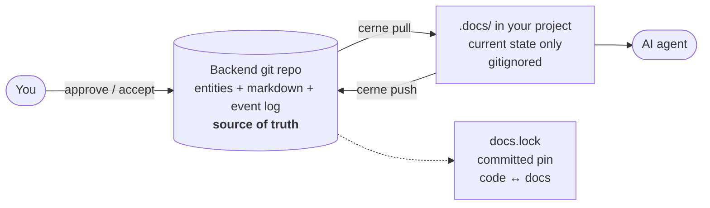

<h1 align="center">cerne</h1>

<p align="center">
  <strong>Living documentation for projects built with AI agents.</strong><br>
  Your agent reads what is true today. Everything else stays searchable, out of its context.
</p>

<p align="center">
  <a href="https://github.com/henriquesakata/cerne/releases/latest"></a>
  <a href="https://github.com/henriquesakata/cerne/actions/workflows/ci.yml"></a>
  <a href="LICENSE"></a>
  
</p>

<p align="center">
  <a href="#try-it-in-two-minutes">Quickstart</a> ·
  <a href="#how-it-works">How it works</a> ·
  <a href="#what-you-get">Features</a> ·
  <a href="INSTALL.md">Install guide</a>
</p>


## The problem

Project documentation is append-only. Specs, plans, ADRs and results pile up, and nothing mechanical tells the document that holds today apart from the one rejected or superseded six months ago.

A human skims and guesses. An AI agent reads everything with the same weight, then confidently cites a design you abandoned in March.

## What cerne does

cerne is a single binary (CLI + local web UI) that keeps the lifecycle of your features and decisions as **structured data** and hands the agent **only the current state**.

- **State is data, never prose.** A feature is `candidate`, `approved`, `in development`, `implemented` or `done` because a gated command moved it there, with an event log behind it. No "Status: WIP" line rotting in a markdown file.
- **The agent reads a projection, not the archive.** `cerne pull` materializes the current state into a gitignored `.docs/` folder with a generated `CONTEXT.md`. Finished, rejected and superseded work stays out.
- **History is kept, and searchable.** Nothing is deleted. `cerne search` and `cerne ask` reach the whole history when you need the why behind a decision.
- **Staleness is linted deterministically.** Because state is data, `cerne lint` can flag a doc that links to a superseded decision, a broken reference, or a feature closed without evidence. No LLM guessing.

### The number

This repository documents itself with cerne. After 359 features:

| | Documents | ~Tokens |
|---|---:|---:|
| Full documentation corpus | 475 | 1,618,000 |
| What the agent actually reads (`.docs/`) | 115 | 33,000 |

**98% of the corpus stays out of the agent's context**, and none of it is lost. Run `cerne savings` on your own project to get your number.

## Try it in two minutes

Install on macOS or Linux:

```bash
curl -fsSL https://raw.githubusercontent.com/henriquesakata/cerne/main/install.sh | sh
```

The script downloads the latest release for your machine, verifies its SHA-256 and installs it without `sudo`. On Windows, or to install by hand or with Go, see [INSTALL.md](INSTALL.md).

Then, inside any git repository. A local bare repo is enough to try it out:

```bash
git init --bare ~/my-project-docs.git
cerne init --backend ~/my-project-docs.git --name my-project
echo ".docs/" >> .gitignore

cerne feature new "Sign in with Google" --context "Users asked for social login."
cerne pull      # materializes the current state into .docs/
cerne status    # features grouped by state
cerne ui        # dashboard and kanban at http://localhost:7717
```

For a team, point `--backend` at an empty private repository on GitHub or GitLab instead.

## How it works



- The **backend** is a plain git repository you own: entities as JSON, content as markdown, events as NDJSON. No server, no SaaS, no database to operate.
- **`.docs/`** is a projection of the current state. It is what the agent reads, and it is regenerated, never hand-curated.
- **`docs.lock`** is committed in your project and pins the code to a documentation snapshot, so a checkout from last year reads last year's docs.

## What you get

| | |
|---|---|
| **Gated lifecycle** | `approve` needs a real spec with an acceptance bar, `start` needs a plan, `complete` needs a result. `approve` and `accept` are human acts by default: the agent cannot sign off its own work. |
| **Kanban and dashboard** | `cerne ui` serves a local web UI: board, epics, activity, flow metrics, lint debts. English and Portuguese. |
| **Decisions, runbooks, notes, references** | ADRs with supersession, operational procedures, durable team knowledge, and external sources registered as provenance instead of loose links. |
| **Search and Q&A over history** | Full-text search (SQLite FTS5) over everything, including what was rejected. `cerne ask` answers with citations. |
| **Deterministic lint** | Stale references, broken links, orphans, missing gate documents, unregistered sources. |
| **Built for parallel agents** | Per-document merge on `pull`, auto-rebase on `push`, a conflict-free `docs.lock` across branches and worktrees. |
| **Claude Code integration** | `cerne init` installs skills and hooks that teach the agent the workflow, so you just ask for the feature. |
| **Single binary** | macOS, Linux and Windows. The UI is embedded. No runtime dependencies. |


## Why not just…

| | Knows the state of work | Lives next to the code | Agent reads only what is current |
|---|:---:|:---:|:---:|
| Issue tracker (Jira, Linear) | yes | no | no |
| Docs-as-code (markdown, ADR folders) | no | yes | no |
| RAG over your docs | no | no | no, it retrieves stale text just as happily |
| **cerne** | **yes** | **yes** | **yes** |

The idea is close to Karpathy's [LLM Wiki](https://gist.github.com/karpathy/442a6bf555914893e9891c11519de94f), with one difference: the lifecycle is data, so staleness is checked by a deterministic lint instead of a model's judgment.

## Status

cerne is young and in daily use. This repository has been built with it since day one, and the 359 features above went through the same gates you would use. Expect rough edges, and please [open an issue](https://github.com/henriquesakata/cerne/issues) when you hit one: feedback from early users shapes what comes next.

The founding design document is [docs/process/cases/0001_founding-spec/spec.md](docs/process/cases/0001_founding-spec/spec.md).

## The name

*Cerne* is Portuguese for heartwood: the hard core at the center of a tree, the part that stays while the tree grows.

## License

[Apache License 2.0](LICENSE).
